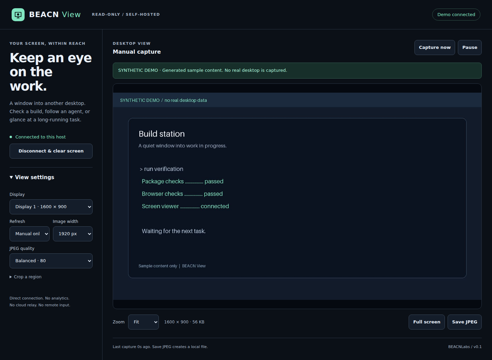
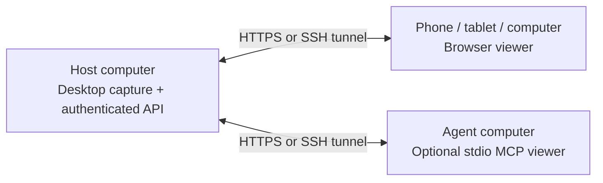

<div align="center">


# BEACN View

**See the work. Wherever you're checking in.**

An open-source screen host + browser viewer, with a read-only MCP bridge for AI agents.

[Get started](#get-started) · [Use cases](#what-can-you-use-it-for) · [Agent setup](docs/MCP.md) · [Security](SECURITY.md) · [Architecture](docs/ARCHITECTURE.md)

</div>



*The screenshot above uses generated demo content. It contains no real desktop, account, or customer data.*

BEACN View lets you glance at a computer's screen from a phone, tablet, another computer, or an MCP-capable agent. Install the **host** on the computer you want to observe. Open the included **viewer** in your browser. You own the connection and the data.

**Early release, v0.1.0.** This is a periodic screenshot viewer for checking progress, not a low-latency video stream. It has no mouse/keyboard control, terminal execution, audio, unattended recording, or shutdown capability.

## What can you use it for?

- **Check an AI agent's work.** See whether a browser, editor, or desktop application is showing the expected result while an agent works on that machine.
- **Follow long jobs.** Glance at a renderer, installer, export, build window, simulation, or training dashboard without taking over the desktop.
- **Check in from your phone.** Read a status dialog, zoom into text, or save one frame for your own notes.
- **Observe a test workstation.** Inspect visible application state during UI testing or remote troubleshooting with the user's consent.
- **Give an agent visual context.** Return a current screen image, capture time and display geometry through MCP, alongside whichever terminal tools you already use.
- **Build your own integration.** Use the small authenticated HTTP API from scripts or another viewer.

A screen image is evidence of visible state. It does **not** prove human inactivity, completion of a background job, or permission to control a computer.

## What's included?

| Capability | Available in v0.1 |
|---|---|
| Capture host | Local desktop capture using open-source Python MSS + Pillow |
| Browser viewer | Responsive interface; no viewer app installation or account required |
| Multiple monitors | List displays and select a monitor |
| Cropped views | Capture a region within the selected display |
| Refresh controls | Manual capture or 1, 2, 5, or 15-second refresh; pause/resume |
| Detail controls | Fit, 100–200% zoom, full screen where supported, selectable image width and JPEG quality |
| Freshness | Capture age, visible stale-frame styling, connection errors |
| Local image export | Save a JPEG explicitly; no automatic disk recording |
| Agent access | Optional stdio MCP server with three observation tools |
| Authentication | Random access token, mandatory on every API endpoint |
| Transport | Loopback HTTP for SSH tunnels; HTTPS required for non-loopback listeners |
| Privacy | No analytics, cloud relay, external fonts/scripts, account registration, or automatic background installation |
| Demo | Generated sample desktop for trying the viewer without capturing your screen |

## Two parts, one small project



The host serves the browser viewer itself. **Only the host needs installation for ordinary browser use.** An agent machine additionally installs the optional MCP package. No paid remote-access app or proprietary host component is required.

## Get started

Requires **Python 3.11+**, pip, and Git for the clone commands. Run the host **inside the logged-in graphical desktop session** you want to view. See [platform support](#platform-support) before installation.

### 1. Install the host

```sh
git clone https://github.com/BEACNLabs/beacn-view.git
cd beacn-view
python -m venv .venv
```

Activate it:

```sh
# macOS / Linux (use python3 instead of python above if needed)
source .venv/bin/activate
```

```powershell
# Windows PowerShell: activation is optional; use the environment directly
.venv\Scripts\python.exe -m pip install .
.venv\Scripts\beacn-view.exe init
.venv\Scripts\beacn-view.exe serve
```

On macOS/Linux, after activation:

```sh
python -m pip install .
beacn-view init
beacn-view serve
```

`init` creates a random token at `~/.beacn-view/access.token` and refuses to replace an existing token. `serve` listens on **127.0.0.1:8741** by default. It runs visibly in the terminal and stops with **Ctrl+C**. It does not register a service or start automatically.

### 2. Connect a viewer

For a same-computer check, open **http://127.0.0.1:8741**. Open the token file locally, copy its contents, paste into the viewer, and choose **Connect to screen**.

For another computer, keep the host on loopback and create an SSH tunnel from the viewing computer:

```sh
ssh -N -L 8741:127.0.0.1:8741 your-user@your-host
```

Then open **http://127.0.0.1:8741** on the viewing computer. Transfer the token through a trusted private channel. The SSH server must already be configured; BEACN View does not install one.

**Phone/tablet or direct network access:** run with a certificate trusted by the viewing device:

```sh
beacn-view serve --bind 0.0.0.0 --allow-host screen.example.com \
  --cert-file /path/to/fullchain.pem --key-file /path/to/private-key.pem
```

Open `https://screen.example.com:8741`. Use your own hostname and certificate; the example domain is a placeholder. Scope network access to your intended devices. A private VPN alone does not replace the host's TLS requirement. See [connection recipes and troubleshooting](docs/CONNECTIONS.md).

### 3. Look, pause, zoom

Choose a display, set your refresh interval, and check the image. Use **Capture now** for one frame, **Pause** to retain the last image, and **Save JPEG** only when you want a file. Hidden tabs stop requesting frames. **Disconnect & clear screen** aborts requests, clears the token, and removes the displayed image.

### Try it without sharing a desktop

```sh
beacn-view init  # skip if you already initialized a token
beacn-view serve --demo
```

Demo mode generates a labeled sample scene. It does not access desktop capture APIs. Authentication is still required. This is also useful on a headless development machine.

## Give an agent eyes

Install the optional MCP extra on the **agent's machine**:

```sh
python -m pip install '.[mcp]'
```

Connect a stdio MCP client to `beacn-view mcp --url http://127.0.0.1:8741 --token-file /private/path/access.token`. That URL can be the viewing end of the SSH tunnel above. Remote URLs must use HTTPS; the client verifies certificates and refuses redirects.

| Tool | Returns |
|---|---|
| `screen_status` | Reachability, version, read-only status and whether this is demo mode |
| `screen_monitors` | Display IDs, dimensions and desktop offsets |
| `screen_capture` | JPEG image plus timestamp, unique frame ID, source region and output dimensions |

See [complete MCP configuration](docs/MCP.md). Credentials stay in a local file, outside tool arguments and configuration examples. An AI provider may receive the image when its agent calls a tool; review that provider's data handling. BEACN View itself does not upload images to an AI service.

## Save one frame from a script

```sh
beacn-view capture --url http://127.0.0.1:8741 \
  --token-file /private/path/access.token --output check.jpg
```

The command refuses to overwrite a file. It prints frame metadata, not token or image bytes. HTTP API details are in [Architecture](docs/ARCHITECTURE.md).

## Platform support

| Host environment | Status / requirement |
|---|---|
| Windows desktop | MSS backend supports native Windows. Run native Python in the logged-in desktop, **not WSL or a session-0 service**. Native acceptance testing is pending for this release. |
| macOS desktop | MSS backend supports macOS. Grant screen-recording permission to the terminal/Python host. Native acceptance testing is pending. |
| Linux X11 | Requires a graphical X11 session and access to its display. Automated capture is tested on a synthetic X11 desktop. |
| Linux Wayland | Native Wayland capture is not implemented. Use an X11 session; XWayland is not full Wayland desktop support. |
| Headless / locked desktop | Not a supported general-purpose target. Capture may fail or return blank; use demo mode for headless testing. |
| Android / iOS | Browser viewer only; phone-screen hosting is not implemented. Responsive browser testing is not physical-device certification. |

See [validation scope](docs/VALIDATION.md). Do not interpret an OS backend's availability as a tested native installer: this release ships source, not signed installers.

## Privacy and security

This repository contains only standalone source, public documentation, and synthetic demo assets. It includes no real screen captures, private machine addresses, hostnames, credentials, operating runbooks, or account exports.

Every screen API request needs the bearer token. The viewer keeps it in memory only—no cookies, local storage, URL parameters, or service worker. Frames are marked `no-store`; access logging is off. The host does not initiate outbound connections. Browser extensions, the OS, and a viewer who saves an image are outside that guarantee.

**Anyone with the token and network access can view every accessible display while the host runs.** There is no per-user permission system or host-side redaction. To revoke access, stop the host, generate a new token file, and restart with it. Use this only for desktops you own or have permission to observe. Read [SECURITY.md](SECURITY.md) for the threat model and reporting guidance.

## Develop and contribute

```sh
python -m pip install '.[dev,mcp]'
python -m pytest
python -m build
```

The browser uses plain HTML, CSS and JavaScript; no frontend build is required. [CONTRIBUTING.md](CONTRIBUTING.md) explains tests and privacy requirements. Dependencies are pinned in `pyproject.toml`; [THIRD_PARTY.md](THIRD_PARTY.md) lists upstream projects and licenses.

Future possibilities include a Wayland portal backend, native installers and opt-in recording. They are not implemented features or release commitments. The current project deliberately exposes observation only.

## License

[MIT](LICENSE) · Built by [BEACNLabs](https://github.com/BEACNLabs).

Explore the [BEACNLabs public tools directory](https://github.com/BEACNLabs/tools).
